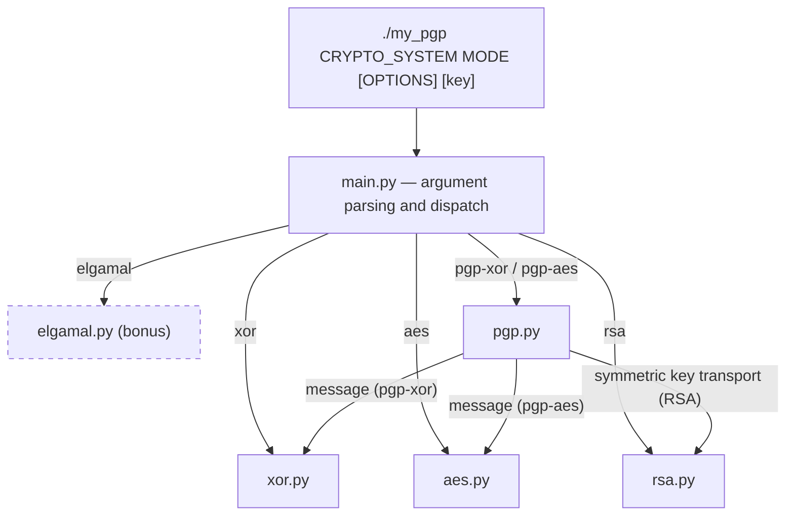

# my_pgp

A PGP-like cryptographic toolbox: several cipher systems behind a single
command line, from a one-time-pad XOR to the hybrid construction that gives
PGP its name — a symmetric cipher for the message, RSA to protect the key.

Built for the Epitech project G-CNA-500 (my_pgp).

## Crypto systems

| System | Kind | Status |
|---|---|---|
| `xor` | symmetric | done |
| `aes` | symmetric, 128/192/256-bit keys | done |
| `rsa` | asymmetric | done |
| `pgp-xor` | hybrid (RSA + XOR) | done |
| `pgp-aes` | hybrid (RSA + AES) | done |
| `elgamal` | asymmetric (bonus) | done |

## Build and run

Requires Python 3.9 or later. No third-party dependency.

```
make            # builds ./my_pgp
make tests      # runs the 120 unit and integration tests
make clean      # removes caches
make fclean     # also removes the binary
```

Examples (all numbers are hexadecimal, little-endian):

```
$ ./my_pgp -h
$ ./my_pgp rsa -g d3 e3
public key: 0101-19bb
private key: 9d5b-19bb
$ echo "WF" | ./my_pgp rsa -c 0101-19bb
8f84
$ echo "8f84" | ./my_pgp rsa -d 9d5b-19bb
WF
$ echo "You know nothing, Jon Snow" | ./my_pgp xor -c -b 576861742069732064656164206d6179206e6576657220646965
20070f2700071c6a4449060a490515164e4e12190b190011063c
$ echo "All men must die" | ./my_pgp aes -c -b 57696e74657220697320636f6d696e67
744ce22c385958348f0df26eceb62eef
$ echo "All men must die" | ./my_pgp pgp-aes -c -b 57696e74657220697320636f6d696e67:010001-...fb3
$ ./my_pgp elgamal -g 17 05 07
public key: 11-17-05
private key: 07-17-05
```

The message is always read on the standard input; the key comes as an
argument. See `./my_pgp -h` for the full usage.

## Architecture



Each system is one module with the same entry point signature
(`run_*(mode, key, block, data)`), dispatched by `main.py`. The PGP modes
are a single routine parameterized by the symmetric engine: cipher the
message with the symmetric key, cipher the symmetric key with the
recipient's RSA public key, print the ciphered key then the ciphered
message.

Inside each symmetric module the algorithm itself is kept free of any
representation concern: `cipher_xor`, `decipher_xor`, `cipher_aes` and
`decipher_aes` take bytes and return bytes, and the hexadecimal and byte
order conversions happen at the edges, in the `run_*` entry points. This is
what lets `pgp.py` reuse the engines without them printing anything.

## Numbers

All numbers in arguments and outputs are hexadecimal in little-endian byte
order: the lowest byte comes first. `"19bb"` is 0xBB19 = 47897. The message
itself is a sequence of bytes, read as a little-endian number when an
algorithm needs a number.

For AES the convention applies **per 32-bit word**: each group of 4 bytes of
the key and of the ciphered output is reversed, not the 16 bytes as a whole.
`docs/AES.md` details how this was established from the subject's example.

## Tests and documentation

- `make tests` — 120 tests, including every example of the subject as a
  fixed vector, plus the official FIPS-197 vectors for AES.
- `docs/XOR.md`, `docs/AES.md`, `docs/RSA.md`, `docs/ELGAMAL.md` — how each
  algorithm works and its limits.
- `BONUS.md` — what was done beyond the mandatory scope.

## Authors

- Hugo Sorgues — RSA, pgp-xor, ElGamal, test suite, documentation
- Kévin Huynh — CLI and argument parsing, XOR, AES, pgp-aes
